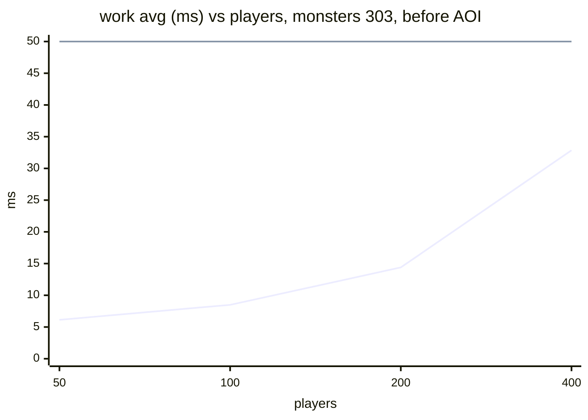

# 부하 테스트 기록

AOI 적용 전후를 같은 조건에서 비교하려고 남기는 측정 기록이다. 모든 숫자는 `results.csv`의 한 줄에서 나오고, 그 줄에는 측정한 코드의 커밋 해시가 붙어 있다.

## 실행

```powershell
.\Test\Load\Run-Load.ps1 -Build -Players 50 -NoRecord                    # 기록 확인용 (빌드 포함)
.\Test\Load\Run-Load.ps1 -Players 100 -Monsters 300 -Label baseline     # 기록됨
```

| 인자 | 기본값 | 뜻 |
|---|---|---|
| `-Players` | 100 | 봇 수 (DummyClient `--bot`, 계정 `load_1`부터 다시 씀) |
| `-Monsters` | 300 | 부하용 몬스터 수 (GameServer `--load-monsters`, 시드 고정이라 배치가 매번 같음) |
| `-Area` | 100 | 봇과 몬스터가 퍼지는 범위 ±m (월드 200m x 200m 전체) |
| `-WarmupSec` | 60 | 봇이 맵에 흩어지는 시간 (측정에서 뺌) |
| `-MeasureSec` | 60 | 측정 시간 |
| `-Label` | baseline | 결과 줄 이름 (예: `baseline`, `aoi`) |
| `-Configuration` | Release | 측정은 Release로만 한다 |
| `-NoRecord` | | `results.csv`에 남기지 않음 |

준비: MySQL80 실행, OutGameServer 비밀값(`OutGameServer/Setup-Secrets.ps1`), Release 빌드(`-Build`).

## 남는 것

- 원본: `Test/logs/load/<시각>_<label>_p<N>_m<M>/` (gitignore)
  - `env.txt` 측정 환경 (CPU, RAM, OS, 빌드 구성, git 커밋, 실행 인자)
  - `server.txt` 서버 로그 전체, `bots.txt`, `outgame.txt`
  - `process.csv` 1초마다 서버 프로세스 CPU / 메모리 / 스레드 수
  - `summary.txt` 측정 구간 계산 결과와 계산에 쓴 `[Room]` 줄
- 정리본: `Docs/LoadTest/results.csv` (커밋 대상)

## results.csv 열

| 열 | 뜻 | 출처 |
|---|---|---|
| `commit`, `dirty` | 측정한 코드. `dirty=True`면 커밋 안 된 변경이 있던 측정이라 근거로 쓰지 않음 | git |
| `players_entered`, `players_in_room`, `monsters_in_room` | 실제로 들어온 수 | 봇 로그, `[Room]` 줄 |
| `tick_interval_avg_ms`, `tick_interval_max_ms` | 틱 사이 간격. 50ms면 정상, 넘으면 틱이 밀림 | `[Room]` 줄 |
| `work_avg_ms`, `work_max_ms` | 틱 하나를 처리하는 데 걸린 시간. **핵심 지표** (예산 50ms) | `[Room]` 줄 |
| `packets_per_s`, `kb_per_s` | Room이 보낸 패킷 수와 양 (헤더 포함) | `[Room]` 줄 (`Room::SendTo`에서 셈) |
| `cpu_cores_avg`, `cpu_cores_max` | 서버가 쓴 CPU를 "코어 몇 개분"으로 | `Get-Process` |
| `cpu_pct_avg` | 위 값을 PC 전체 기준 %로 | `Get-Process` |
| `mem_mb_avg`, `mem_mb_max` | 서버 Working Set | `Get-Process` |

## 측정 계획

| 측정 | 고정 | 늘리는 것 | 보려는 것 |
|---|---|---|---|
| 1 | 몬스터 300 | 플레이어 50 → 100 → 200 → 400 | 브로드캐스트 N² (모두에게 모든 이동) |
| 2 | 플레이어 100 | 몬스터 100 → 300 → 1000 | 몬스터 AI가 플레이어를 전부 훑는 비용 |

## 읽을 때 주의

- **봇이 서버와 같은 PC에서 돈다.** 봇도 CPU를 쓰고 같은 양을 받으므로, 절대 수치보다 같은 조건에서의 전후 비교로 본다.
- **CPU %만 보면 안 된다.** Room 잡큐는 한 번에 한 스레드만 실행하므로, Room이 꽉 차도 프로세스 CPU는 코어 1개분 근처에서 멈춘다. 한계 판단은 `work_avg_ms`와 `tick_interval_avg_ms`로 한다.
- `[Room]` 줄은 10초 구간 통계라서, 측정 창에서 처음 쓰는 줄은 최대 10초 전부터의 구간을 포함할 수 있다 (워밍업 뒤라 이미 정상 상태).
- 60초마다 주기 저장(전원 값 복사)이 측정 창 안에 한 번 들어간다. 실제 운영과 같은 조건이라 빼지 않는다.

## 결과

### 기준선 (AOI 적용 전, 커밋 `9f045d1`, 2026-11-13)

환경: i5-13600KF (14코어 20스레드), RAM 32GB, Windows 11 (26200), Release x64. 봇은 서버와 같은 PC. 모든 실행에서 입장 실패 0, 서버 생존. 원본은 `results.csv`의 `run_dir` 폴더.

**측정 1: 플레이어 증가 (몬스터 303)**

| 플레이어 | work avg | work max | 송신 KB/s | 한 명당 KB/s | 송신 패킷/s | CPU (코어분) | 메모리 |
|---|---|---|---|---|---|---|---|
| 50 | 6.13ms | 17.5ms | 2,922 | 58 | 1,932 | 0.20 | 699MB |
| 100 | 8.49ms | 23.8ms | 7,245 | 72 | 4,583 | 0.18 | 733MB |
| 200 | 14.39ms | 43.9ms | 19,274 | 96 | 10,650 | 0.27 | 801MB |
| 400 | **32.85ms** | **128.8ms** | **56,623** | 142 | 28,147 | 0.73 | 937MB |

**측정 2: 몬스터 증가 (플레이어 100)**

| 몬스터 | work avg | work max | 송신 KB/s | 송신 패킷/s | CPU (코어분) |
|---|---|---|---|---|---|
| 103 | 6.05ms | 15.4ms | 3,830 | 2,785 | 0.16 |
| 303 | 8.49ms | 23.8ms | 7,245 | 4,583 | 0.18 |
| 1003 | 14.31ms | 44.5ms | 18,925 | 10,048 | 0.32 |



### 해석

- **송신량이 제곱에 가깝게 는다.** 플레이어가 2배 될 때 송신 KB/s는 2.5배 → 2.7배 → 2.9배로 커지고, 한 명이 받는 양도 58 → 142KB/s로 늘었다. 모두에게 모든 이동을 보내는 구조라서 "보내는 사람 수 x 받는 사람 수"가 되기 때문이다. 플레이어 비중이 커질수록 4배(순수 N²)에 가까워진다.
- **틱 처리 시간도 같은 모양이다.** 400명에서 평균 32.9ms로 예산 50ms의 66%를 쓰고, 최대는 100~129ms로 10초 구간마다 예산을 2배 넘게 넘었다. 평균 틱 간격은 50ms로 유지됐는데, 다음 틱 목표 시각을 누적해서 잡기 때문에 늦은 틱 뒤에 바로 따라잡기 때문이다. 유저 입장에서는 이 순간 이동이 끊겨 보인다.
- **몬스터도 플레이어 수와 곱해진다.** 플레이어 100명 고정에서 몬스터 10배(103 → 1003)에 송신은 4.9배, 처리 시간은 2.4배. 몬스터 이동 하나가 100명 모두에게 가기 때문이다.
- **CPU %로는 보이지 않는다.** 400명에서도 서버는 평균 0.73코어분(PC 전체의 3.6%)만 쓴다. Room 잡큐 하나가 한 번에 한 스레드에서만 돌기 때문에, 한계는 CPU 총량이 아니라 "Room 하나의 틱 시간"에서 온다.
- 메모리는 측정 구간 안에서 변하지 않았다 (400명: 934.5 ~ 934.7MB). 클라가 못 받아서 송신이 쌓이는 상황은 아직 아니다.

### 측정 준비 중 발견해서 고친 것

- **큰 패킷 크래시** (`fd3e97f`): S_MOVE 하나에 그 틱의 모든 이동, S_SPAWN 하나에 방의 모든 객체를 담았는데 SendBuffer 청크가 6000바이트라, 한 틱에 약 130개가 움직이거나 방에 약 110개가 있을 때 들어오면 서버가 죽었다. 4000바이트씩 나눠 보내도록 고쳤다.
- **Release에서만 나는 크래시** (`d59f079`): nullptr 쓰기는 UB라서 MSVC 최적화가 `CRASH` 매크로의 쓰기를 ASSERT 분기 밖(DummyClient main 루프 앞)으로 옮겼다. Windows 크래시 기록의 오프셋을 디스어셈블리와 맞춰 찾았고, 포인터를 `volatile`로 바꿔 고쳤다.
