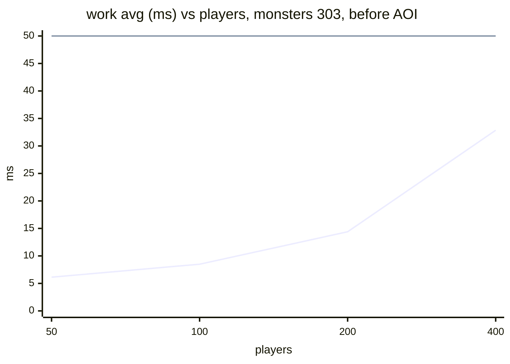
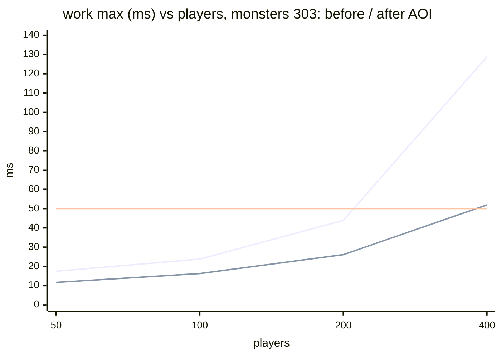
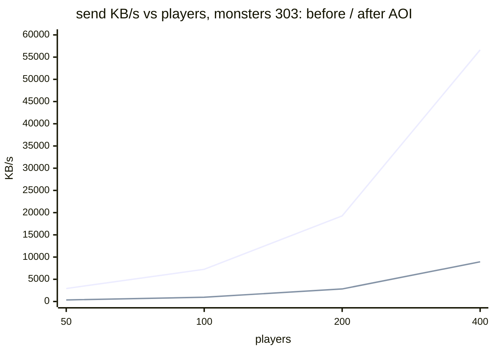
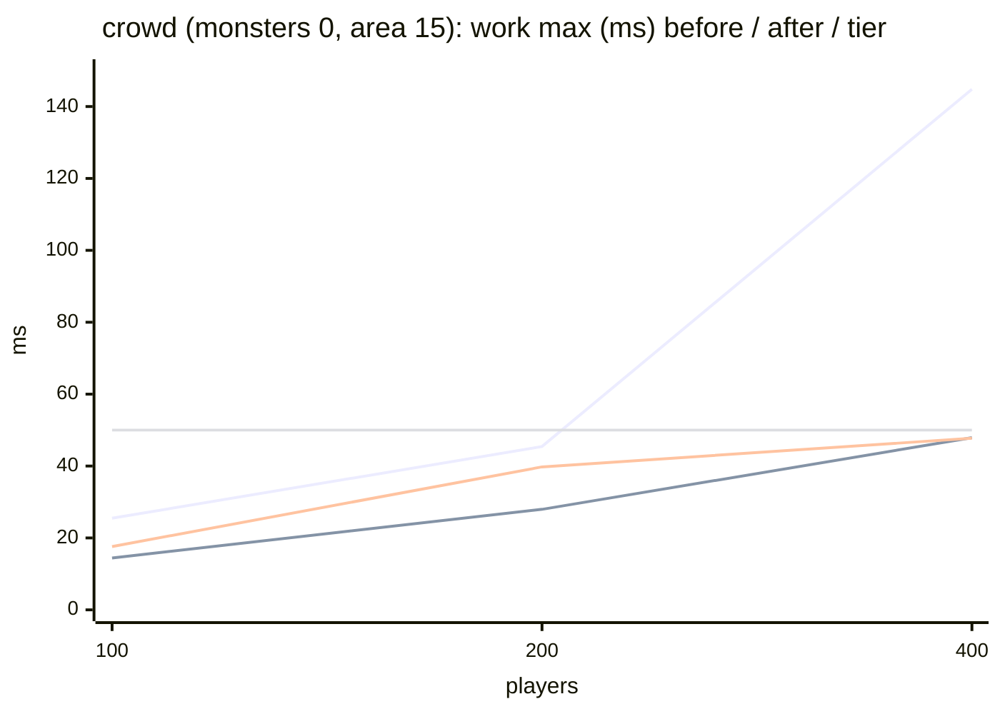
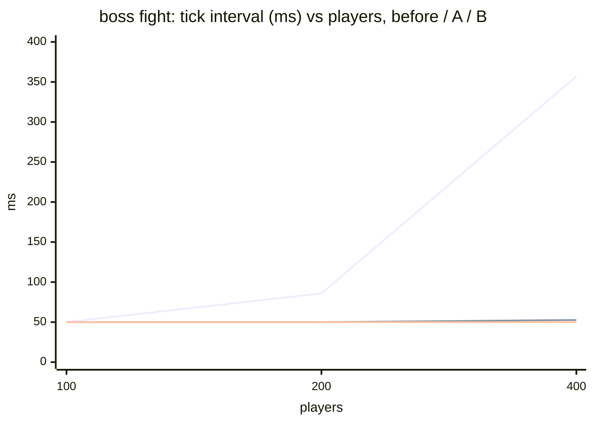

# 부하 테스트 기록

AOI 적용 전후를 같은 조건에서 비교하려고 남기는 측정 기록이다. 모든 숫자는 `results.csv`의 한 줄에서 나오고, 그 줄에는 측정한 코드의 커밋 해시가 붙어 있다.

## 실행

```powershell
.\Test\Load\Run-Load.ps1 -Build -Players 50 -NoRecord                    # 기록 확인용 (빌드 포함)
.\Test\Load\Run-Load.ps1 -Players 100 -Monsters 300 -Label baseline     # 기록됨
```

| 인자 | 기본값 | 뜻 |
|---|---|---|
| `-Players` | 100 | 봇 수 (DummyClient `--bot`, 계정 `load_1`부터 다시 씀) |
| `-Monsters` | 300 | 부하용 몬스터 수 (GameServer `--load-monsters`, 시드 고정이라 배치가 매번 같음) |
| `-Area` | 100 | 봇과 몬스터가 퍼지는 범위 ±m (월드 200m x 200m 전체) |
| `-WarmupSec` | 60 | 봇이 맵에 흩어지는 시간 (측정에서 뺌) |
| `-MeasureSec` | 60 | 측정 시간 |
| `-Label` | baseline | 결과 줄 이름 (예: `baseline`, `aoi`) |
| `-Configuration` | Release | 측정은 Release로만 한다 |
| `-NoRecord` | | `results.csv`에 남기지 않음 |
| `-Boss` | | 보스전: GameServer `--load-boss 2`(TestBoss, (0, 0)) + DummyClient `--bot-attack`(보스에게 붙어서 기본 공격). `results.csv`에 열이 없어서 `-Label`로 구분하고, 명중 수 / 스킬 처리 시간은 `summary.txt`에만 |
| `-SaveIntervalSec` | 0 (서버 기본 60초) | 주기 저장 간격 (GameServer `--save-interval-sec`). 짧게 주면 저장이 로그인과 자주 겹침 |
| `-Wave` | 0 | 측정 시작 때 두 번째 봇 무리를 한꺼번에 입장시킴 (계정 `loadw_1`부터). 이미 사람이 있는 서버에 몰리는 로그인 |
| `-WaveReuse` | | 두 번째 무리가 첫 무리와 같은 계정(`load_1`부터)으로 들어옴 = 전원 중복 로그인 (재접속 폭주). `-Wave`는 `-Players` 이하 |

준비: MySQL80 실행, OutGameServer 비밀값(`OutGameServer/Setup-Secrets.ps1`), Release 빌드(`-Build`).

## 남는 것

- 원본: `Test/logs/load/<시각>_<label>_p<N>_m<M>/` (gitignore)
  - `env.txt` 측정 환경 (CPU, RAM, OS, 빌드 구성, git 커밋, 실행 인자)
  - `server.txt` 서버 로그 전체, `bots.txt`, `outgame.txt`, `bots-wave.txt`(`-Wave`일 때)
  - `process.csv` 1초마다 서버 프로세스 CPU / 메모리 / 스레드 수
  - `summary.txt` 측정 구간 계산 결과와 계산에 쓴 `[Room]` 줄, `[DB]` 줄, `[Room] enter` 줄
- 정리본: `Docs/LoadTest/results.csv` (커밋 대상)

## results.csv 열

| 열 | 뜻 | 출처 |
|---|---|---|
| `commit`, `dirty` | 측정한 코드. `dirty=True`면 커밋 안 된 변경이 있던 측정이라 근거로 쓰지 않음 | git |
| `players_entered`, `players_in_room`, `monsters_in_room` | 실제로 들어온 수 | 봇 로그, `[Room]` 줄 |
| `tick_interval_avg_ms`, `tick_interval_max_ms` | 틱 사이 간격. 50ms면 정상, 넘으면 틱이 밀림 | `[Room]` 줄 |
| `work_avg_ms`, `work_max_ms` | 틱 하나를 처리하는 데 걸린 시간. **핵심 지표** (예산 50ms) | `[Room]` 줄 |
| `packets_per_s`, `kb_per_s` | Room이 보낸 패킷 수와 양 (헤더 포함) | `[Room]` 줄 (`Room::SendTo`에서 셈) |
| `cpu_cores_avg`, `cpu_cores_max` | 서버가 쓴 CPU를 "코어 몇 개분"으로 | `Get-Process` |
| `cpu_pct_avg` | 위 값을 PC 전체 기준 %로 | `Get-Process` |
| `mem_mb_avg`, `mem_mb_max` | 서버 Working Set | `Get-Process` |
| `enter_p50_ms`, `enter_p95_ms`, `enter_p99_ms`, `enter_max_ms` | 입장 지연: 봇이 C_ENTER_GAME을 보낸 뒤 S_ENTER_GAME(성공)을 받기까지 (nearest-rank 백분위). 서버가 틱 끝에 보내서 바닥이 최대 50ms. 이 열이 생기기 전 줄은 비어 있음 | 봇 로그 `enter_ms` |
| `save_interval_s`, `wave_players`, `wave_reuse`, `wave_entered` | DB 상황: 주기 저장 간격, 두 번째 무리 인원, 같은 계정으로 들어왔는지, 실제로 들어온 수 | 실행 인자, `bots-wave.txt` |
| `wave_enter_p50_ms` ~ `wave_enter_max_ms` | 두 번째 무리의 입장 지연 (위 `enter_*`와 같은 방식). DB 줄이 막히면 여기가 먼저 늘어남 | `bots-wave.txt` `enter_ms` |
| `db_load_count`, `db_load_wait_avg_ms`, `db_load_wait_max_ms`, `db_load_run_avg_ms` | 캐릭터 불러오기: 건수, DB 줄에서 기다린 시간(요청 ~ 실행 시작), 쿼리 시간. 중복 로그인은 옛 세션의 저장을 기다린 시간까지 wait에 들어감 | `[DB]` 줄 (`DBQueue::LogStats`) |
| `db_leave_count`, `db_leave_run_avg_ms` | 나감 저장 건수와 한 명 저장 시간 | `[DB]` 줄 |
| `db_save_count`, `db_save_rows`, `db_save_run_max_ms` | 주기 저장 횟수, 저장한 캐릭터 수, 가장 오래 걸린 한 번. 이 시간 동안 같은 줄의 로그인이 기다림 | `[DB]` 줄 |
| `tick_interval_peak_ms` | 측정 구간에서 틱 하나의 가장 긴 간격. `tick_interval_max_ms`는 200틱 평균 중 최댓값이라 한 번의 큰 밀림이 묻힘 | `[Room]` 줄 끝 `interval max` |
| `enter_server_avg_ms`, `enter_server_max_ms` | 첫 무리: 서버 안에서 쓴 입장 시간 (C_ENTER_GAME 받음 ~ S_ENTER_GAME 실제 송신) | `[Room] enter` 줄 (`Room::LogStats`), 측정 시작 전 |
| `enter_db_avg_ms` | 첫 무리: 받음 ~ DB 불러오기 끝 (DB 줄 대기 + 쿼리) | `[Room] enter` 줄 |
| `enter_room_wait_avg_ms`, `enter_room_wait_max_ms` | 첫 무리: DB 줄이 넘긴 `Room::Enter`가 Room 줄에서 기다린 시간 | `[Room] enter` 줄 |
| `enter_run_avg_ms` | 첫 무리: `Room::Enter` 하나의 처리 시간 (시야 채우기 포함) | `[Room] enter` 줄 |
| `enter_send_wait_avg_ms`, `enter_send_wait_max_ms` | 첫 무리: `Room::Enter` 끝 ~ 틱 끝 `FlushSends` (실제 송신) | `[Room] enter` 줄 |
| `wave_server_*`, `wave_db_avg_ms`, `wave_room_wait_*`, `wave_run_avg_ms`, `wave_send_wait_*` | 두 번째 무리: 위 8개와 같은 값 | `[Room] enter` 줄, 측정 시작 후 |

## 측정 계획

| 측정 | 고정 | 늘리는 것 | 보려는 것 |
|---|---|---|---|
| 1 | 몬스터 300 | 플레이어 50 → 100 → 200 → 400 | 브로드캐스트 N² (모두에게 모든 이동) |
| 2 | 플레이어 100 | 몬스터 100 → 300 → 1000 | 몬스터 AI가 플레이어를 전부 훑는 비용 |
| 3 | 몬스터 0, 범위 ±15m | 플레이어 100 → 200 → 400 | 필드보스 주변처럼 모두가 서로의 시야 안에 몰린 상황 (AOI가 거르지 못함) |
| 4 | 측정 3 + `-Boss` | 플레이어 100 → 200 → 400 | 몰린 채로 모두가 보스 한 마리를 계속 때리는 상황 (맞을 때마다 생기는 이벤트) |
| 5 | 플레이어 400, 몬스터 0 | 빈 서버 입장 / `-SaveIntervalSec 10 -Wave 400` / `-Wave 400 -WaveReuse` | DB 줄 하나(`GDBQueue`)에 불러오기와 저장이 몰릴 때 입장이 얼마나 기다리는지 |
| 6 | 측정 5와 같음 | 같은 세 상황 | 입장 시간이 서버 안 어느 구간(DB / Room 줄 대기 / Enter 처리 / 틱 끝 송신 대기)에서 쓰이는지 |

## 읽을 때 주의

- **봇이 서버와 같은 PC에서 돈다.** 봇도 CPU를 쓰고 같은 양을 받으므로, 절대 수치보다 같은 조건에서의 전후 비교로 본다.
- **CPU %만 보면 안 된다.** Room 잡큐는 한 번에 한 스레드만 실행하므로, Room이 꽉 차도 프로세스 CPU는 코어 1개분 근처에서 멈춘다. 한계 판단은 `work_avg_ms`와 `tick_interval_avg_ms`로 한다.
- `[Room]` 줄은 200틱(정상이면 10초) 구간 통계라서, 측정 창에서 처음 쓰는 줄은 그 전부터의 구간을 포함할 수 있다 (워밍업 뒤라 이미 정상 상태). 틱이 밀리면 한 줄이 10초보다 길어지므로, 초당 값은 "200틱 x 그 줄의 평균 틱 간격"으로 나눈다.
- `work`는 틱 함수 안의 시간만이다. 패킷 핸들러가 Room에 넘긴 잡(`HandleSkill` 등)은 틱 밖에서 돌아서 안 잡힌다. 보스전처럼 그쪽이 무거우면 `work`는 멀쩡한데 틱 간격이 밀린다 -> `summary.txt`의 `skill work ms/s`와 틱 간격을 같이 본다.
- 60초마다 주기 저장(전원 값 복사)이 측정 창 안에 한 번 들어간다. 실제 운영과 같은 조건이라 빼지 않는다.
- `db_*` 열은 측정 창이 아니라 **실행 전체**의 `[DB]` 줄로 계산한다 (첫 무리의 로그인은 워밍업 전에 일어남). 서버를 강제로 끄므로 정리할 때의 나감 저장은 안 들어간다. 평균은 10초 줄마다의 평균을 건수로 가중해서 합친 값이다.
- `9b2978a`부터 DB 줄이 4개라 `[DB]` 줄도 줄마다 하나씩 찍힌다(끝에 `queue N`). 그래서 `db_save_count`는 주기 저장 한 번이 4건으로 세어지고, `db_save_run_max_ms`는 가장 느린 줄의 저장 시간이다.
- 입장 구간: 봇의 입장 지연(`enter_p50_ms`)에서 서버 안 시간(`enter_server_avg_ms`)을 빼면 네트워크와 봇 처리 시간이다 (백분위와 평균이라 대략으로만). `enter_*` 서버 열은 측정 시작 전(첫 무리), `wave_*` 서버 열은 측정 시작 후(두 번째 무리)의 `[Room] enter` 줄이다.

## 결과

### 기준선 (AOI 적용 전, 커밋 `9f045d1`, 2026-11-13)

환경: i5-13600KF (14코어 20스레드), RAM 32GB, Windows 11 (26200), Release x64. 봇은 서버와 같은 PC. 모든 실행에서 입장 실패 0, 서버 생존. 원본은 `results.csv`의 `run_dir` 폴더.

**측정 1: 플레이어 증가 (몬스터 303)**

| 플레이어 | work avg | work max | 송신 KB/s | 한 명당 KB/s | 송신 패킷/s | CPU (코어분) | 메모리 |
|---|---|---|---|---|---|---|---|
| 50 | 6.13ms | 17.5ms | 2,922 | 58 | 1,932 | 0.20 | 699MB |
| 100 | 8.49ms | 23.8ms | 7,245 | 72 | 4,583 | 0.18 | 733MB |
| 200 | 14.39ms | 43.9ms | 19,274 | 96 | 10,650 | 0.27 | 801MB |
| 400 | **32.85ms** | **128.8ms** | **56,623** | 142 | 28,147 | 0.73 | 937MB |

**측정 2: 몬스터 증가 (플레이어 100)**

| 몬스터 | work avg | work max | 송신 KB/s | 송신 패킷/s | CPU (코어분) |
|---|---|---|---|---|---|
| 103 | 6.05ms | 15.4ms | 3,830 | 2,785 | 0.16 |
| 303 | 8.49ms | 23.8ms | 7,245 | 4,583 | 0.18 |
| 1003 | 14.31ms | 44.5ms | 18,925 | 10,048 | 0.32 |



### 해석

- **송신량이 제곱에 가깝게 는다.** 플레이어가 2배 될 때 송신 KB/s는 2.5배 → 2.7배 → 2.9배로 커지고, 한 명이 받는 양도 58 → 142KB/s로 늘었다. 모두에게 모든 이동을 보내는 구조라서 "보내는 사람 수 x 받는 사람 수"가 되기 때문이다. 플레이어 비중이 커질수록 4배(순수 N²)에 가까워진다.
- **틱 처리 시간도 같은 모양이다.** 400명에서 평균 32.9ms로 예산 50ms의 66%를 쓰고, 최대는 100~129ms로 10초 구간마다 예산을 2배 넘게 넘었다. 평균 틱 간격은 50ms로 유지됐는데, 다음 틱 목표 시각을 누적해서 잡기 때문에 늦은 틱 뒤에 바로 따라잡기 때문이다. 유저 입장에서는 이 순간 이동이 끊겨 보인다.
- **몬스터도 플레이어 수와 곱해진다.** 플레이어 100명 고정에서 몬스터 10배(103 → 1003)에 송신은 4.9배, 처리 시간은 2.4배. 몬스터 이동 하나가 100명 모두에게 가기 때문이다.
- **CPU %로는 보이지 않는다.** 400명에서도 서버는 평균 0.73코어분(PC 전체의 3.6%)만 쓴다. Room 잡큐 하나가 한 번에 한 스레드에서만 돌기 때문에, 한계는 CPU 총량이 아니라 "Room 하나의 틱 시간"에서 온다.
- 메모리는 측정 구간 안에서 변하지 않았다 (400명: 934.5 ~ 934.7MB). 클라가 못 받아서 송신이 쌓이는 상황은 아직 아니다.

### AOI 적용 후 (커밋 `5d7ffab`, 2026-11-14)

같은 PC, 같은 조건(Release, 워밍업 60초, 측정 60초, 시드 고정 몬스터 배치). 모든 실행에서 입장 실패 0, 서버 생존. AOI 규칙: 30m 안이면 보이기 시작, 35m 밖이면 사라짐, 35m 칸 6x6 그리드로 근처만 검사, 매 틱 시야 다시 계산.

**측정 1: 플레이어 증가 (몬스터 303), 기준선 → AOI**

| 플레이어 | work avg | work max | 송신 KB/s | 한 명당 KB/s | 송신 패킷/s | 시야 안 객체 (한 명 평균) | 메모리 |
|---|---|---|---|---|---|---|---|
| 50 | 6.13 → 6.26ms | 17.5 → 11.7ms | 2,922 → 354 (-88%) | 58 → 7 | 1,932 → 974 | 34 | 699 → 707MB |
| 100 | 8.49 → 9.01ms | 23.8 → 16.3ms | 7,245 → 959 (-87%) | 72 → 10 | 4,583 → 2,183 | 47 | 733 → 753MB |
| 200 | 14.39 → 13.44ms | 43.9 → 26.1ms | 19,274 → 2,824 (-85%) | 96 → 14 | 10,650 → 5,199 | 70 | 801 → 856MB |
| 400 | 32.85 → **25.28ms** | 128.8 → **51.9ms** | 56,623 → **8,932** (-84%) | 142 → 22 | 28,147 → 13,704 | 99 | 937 → 1,105MB |

**측정 2: 몬스터 증가 (플레이어 100), 기준선 → AOI**

| 몬스터 | work avg | work max | 송신 KB/s | 송신 패킷/s |
|---|---|---|---|---|
| 103 | 6.05 → 6.88ms | 15.4 → 14.9ms | 3,830 → 598 (-84%) | 2,785 → 1,445 |
| 303 | 8.49 → 9.01ms | 23.8 → 16.3ms | 7,245 → 959 (-87%) | 4,583 → 2,183 |
| 1003 | 14.31 → 12.23ms | 44.5 → 22.1ms | 18,925 → 2,079 (-89%) | 10,048 → 3,956 |





### AOI 해석

- **송신량이 모든 조건에서 84~89% 줄었다.** 400명에서 한 명이 받는 양이 142 → 22KB/s. 방 전체가 아니라 시야 안(평균 99개)의 변화만 받기 때문이다.
- **부하가 클수록 처리 시간 이득이 크다.** 400명에서 work avg -23%, work max는 129 → 52ms로 예산(50ms)을 넘는 폭이 2.6배에서 경계 수준이 됐다. 몬스터 1003에서도 avg -15%, max -50%.
- **가벼운 조건에서는 오히려 조금 느리다.** 50~100명, 몬스터 103에서 work avg가 0.1~0.8ms 늘었다. 매 틱 플레이어마다 시야를 다시 계산하는 비용이 새로 생겼고, 보낼 양이 원래 적어서 줄어든 송신 비용이 이를 못 덮는다.
- **송신량은 여전히 플레이어 수보다 빠르게 는다** (2배마다 2.7 → 2.9 → 3.2배). 맵(200m x 200m)이 고정이라 사람이 늘면 밀도가 올라가 한 명의 시야 안 객체도 34 → 99로 같이 늘기 때문이다. AOI는 "N x 전체"를 "N x 주변"으로 바꾼 것이고, 주변이 붐비면 그만큼 는다.
- **메모리는 400명에서 168MB 높다.** 측정 60초 동안 늘지 않고 평평했으므로(1,111 → 1,096MB) 쌓이는 문제는 아니다. 플레이어마다 따로 만드는 패킷 버퍼 때문으로 보이지만 원인은 확인하지 않았다.
- **다음 병목:** 400명 프로파일(측정 전 임시 계측, 커밋 안 함)에서 틱 처리의 대부분(약 30ms)이 시야 처리(`UpdateViews`)였고, 그중 절반가량(약 15ms)이 `Session::Send` 안의 WSASend 호출이었다. 플레이어마다 패킷을 따로 보내므로 Room 스레드에서 호출 수가 많다. 후보는 칸 단위로 패킷을 공유하는 방식, 또는 송신을 Room 스레드 밖으로 빼는 것(ServerCore 변경).

### 측정 도구 수정

- AOI 측정의 두 번째 실행부터 `dirty=True`로 기록됐다. 코드는 6번 모두 `5d7ffab` 그대로였고 바뀐 파일은 첫 실행이 쓴 `results.csv`뿐이었다 (각 `env.txt`의 changed files). 기준선 때는 `results.csv`가 아직 커밋 전이라 검사에서 빠져서 드러나지 않았다. `Run-Load.ps1`이 dirty 판단에서 `results.csv`를 빼도록 고치고, 해당 5줄을 `False`로 바로잡았다.

### 측정 준비 중 발견해서 고친 것

- **큰 패킷 크래시** (`fd3e97f`): S_MOVE 하나에 그 틱의 모든 이동, S_SPAWN 하나에 방의 모든 객체를 담았는데 SendBuffer 청크가 6000바이트라, 한 틱에 약 130개가 움직이거나 방에 약 110개가 있을 때 들어오면 서버가 죽었다. 4000바이트씩 나눠 보내도록 고쳤다.
- **Release에서만 나는 크래시** (`d59f079`): nullptr 쓰기는 UB라서 MSVC 최적화가 `CRASH` 매크로의 쓰기를 ASSERT 분기 밖(DummyClient main 루프 앞)으로 옮겼다. Windows 크래시 기록의 오프셋을 디스어셈블리와 맞춰 찾았고, 포인터를 `volatile`로 바꿔 고쳤다.

### 밀집 상황: 보이는 플레이어 상한 + 거리별 갱신 (2026-11-19 ~ 20)

측정 3 조건: `-Monsters 0 -Area 15` (데이터 몬스터 3마리만, 플레이어가 30m x 30m 안에 몰림 -> 거의 모두가 서로의 30m 시야 안). AOI가 아무것도 거르지 못하는 필드보스 주변 상황을 흉내 낸다. Release, 워밍업 60초, 측정 60초, 입장 실패 0, 서버 생존.

| 라벨 | 커밋 | 바뀐 것 |
|---|---|---|
| `crowd-before` | `dcbf339` | AOI만 (시야 안이면 전부 보임, 매 틱 이동 전송) |
| `crowd-after` | `a2cc911` | 다른 플레이어 상한 50명 (가까운 순 + 끈적임 5m), 거리별 이동 전송 간격 (10m 안 매 틱, 20m 안 2틱, 밖 4틱) |
| `crowd-tier` | `b4a7b2a` | 상한 순위를 0.5초마다 다시 매김 (사이 틱은 보이던 사람 유지), 두 겹 우선순위 (작은 시야 10m/12m 안만 자리를 뺏을 수 있음), 끈적임 10m |

**before → after → tier**

| 플레이어 | work avg | work max | 송신 KB/s | 송신 패킷/s | 시야 안 객체 | CPU (코어분) | 메모리 |
|---|---|---|---|---|---|---|---|
| 100 | 6.28 → 4.32 → **4.57ms** | 25.5 → 14.4 → **17.6ms** | 2,260 → 1,179 → **1,164** | 1,581 → 3,037 → **1,774** | 102 → 53 → 53 | 0.16 → 0.10 → 0.12 | 772 → 753 → 753MB |
| 200 | 13.55 → 11.95 → **10.11ms** | 45.4 → 28.0 → **39.8ms** | 9,012 → 2,446 → **2,379** | 4,244 → 7,500 → **3,549** | 202 → 53 → 53 | 0.33 → 0.40 → 0.25 | 961 → 843 → 844MB |
| 400 | 44.73 → 24.53 → **21.15ms** | 144.8 → 47.9 → **47.7ms** | 36,069 → 5,081 → **4,822** (-87%) | 12,708 → 16,903 → **6,806** | 402 → 53 → 53 | 0.99 → 0.81 → 0.50 | 1,575 → 1,025 → 1,027MB |

**시야 교체 수** (10초 동안 S_SPAWN + S_DESPAWN에 들어간 항목, `[Room] view` 줄의 `view changes`. `b4a7b2a`에서 처음 생긴 카운터라 after 값은 같은 코드에 카운터만 넣고 `-NoRecord`로 잰 것)

| 플레이어 | after (매 틱 순위) | 0.5초 재선정만 | tier |
|---|---|---|---|
| 100 | - | 약 8,600 | 약 8,300 |
| 200 | - | 약 30,000 | 약 21,700 |
| 400 | 약 88,700 | 약 81,000 | 약 44,600 |



### 밀집 상황 해석

- **상한이 송신량과 처리 시간을 묶었다.** 400명이 몰려도 한 명이 보는 객체는 53개(플레이어 50 + 몬스터 3)로 고정. 400명 송신량 -87%, work max 145 → 48ms로 틱 예산(50ms) 안에 들어왔다.
- **after에서 패킷 수가 오히려 늘었다** (400명 12,708 → 16,903). 카운터로 확인해 보니 상한 경계에서 한 명당 초당 약 22번(매 틱 1번 이상) 보였다 안 보였다가 바뀌어서 S_SPAWN / S_DESPAWN 패킷이 매 틱 따로 나갔다. 몰린 곳에서는 "50등" 경계를 넘나드는 사람이 늘 있어서, 거리 끈적임(5m)은 경계를 조금 옮길 뿐 교체를 막지 못한다.
- **tier에서 패킷 수가 before의 절반 아래로 내려갔다** (400명 6,806). 순위를 0.5초마다 매기면 교체가 그때 한 묶음으로 나가서 패킷 수가 줄고, 두 겹 우선순위로 바깥(12m 밖)끼리는 자리를 바꾸지 않아서 교체 항목 수도 400명에서 절반이 됐다.
- **남은 교체는 대부분 "10m 안으로 걸어 들어온 사람"이다.** 전투 거리라 보여야 하는 교체다. 부하 봇은 쉬지 않고 무작위로 걸어서 실제 보스전(대부분 서서 싸움)보다 훨씬 많이 생긴다. 100명은 작은 시야 안 인원이 상한보다 적어서 바깥 교체가 원래 적었고, 그래서 tier로 거의 안 줄었다. 이 카운터에는 큰 시야(30/35m) 출입도 섞여 있다 (30m x 30m 구역은 모서리끼리 42m).
- **work 수치의 흔들림.** 같은 `b4a7b2a` 코드로 400명을 4번 쟀을 때 3번은 work avg 21~23ms였고, 나머지 한 번은 중간 30초만 31~34ms(max 95ms)로 튀었다가 돌아왔다 (같은 PC에서 다른 작업이 겹친 것으로 보고 그 줄은 지우고 다시 쟀다). 200명 max(28.0 → 39.8ms)처럼 한 번씩 잰 값의 차이는 이 흔들림 안일 수 있다.

### 보스전: HP 묶기 + 송신 묶기 (2026-11-20)

측정 4 조건: 측정 3(`-Monsters 0 -Area 15`) + `-Boss`. (0, 0)에 부하 테스트용 TestBoss(HP 5천만, 3초마다 1 데미지, 드랍 없음) 한 마리, 봇은 전부 보스 1.8m 안에 멈춰서 0.55초마다 기본 공격(10 데미지). 400명은 틱이 밀리면 60초 동안 `[Room]` 줄이 1~2개뿐이라 측정을 180초로 늘렸다. Release, 입장 실패 0, 서버 생존.

| 라벨 | 커밋 | 바뀐 것 |
|---|---|---|
| `boss-before` | `e2f8acc` (100), `951fd1d` (200, 400) | 시야 상한까지 적용된 상태. 맞을 때마다 보스 `S_CHANGE_HP`를 보스를 보는 전원에게, 공격자 `S_SKILL`을 공격자를 보는 사람에게 (두 커밋은 측정 도구만 다름) |
| `boss-hp` | `2489014` | A: 데미지 숫자는 때린 / 맞은 플레이어에게만 바로, HP바는 바뀐 객체만 2틱(100ms)마다 마지막 값 한 번 (`SetHp` -> `hpDirty` -> `FlushHpChanges`) |
| `boss-send` | `bf69dd4` | B: Room이 보내는 패킷은 큐에 넣기만 하고(`Session::PushSend`), 틱 끝에 세션마다 `FlushSend` 한 번 (WSASend가 패킷마다 -> 세션당 틱마다 한 번) |

**400명: before → A → B**

| | boss-before | boss-hp (A) | boss-send (B) |
|---|---|---|---|
| 틱 간격 평균 / 최대 | **356.9 / 368.5ms** | 52.7 / 56.1ms | **50.0 / 50.2ms** |
| 스킬 처리 시간 (`skill work`, 틱 밖) | 870ms/s | 533ms/s | **25ms/s** |
| work avg / max (틱 안) | 10.8 / 41.3ms | 13.4 / 44.7ms | 14.8 / 43.3ms |
| 실제 명중/s (봇이 원하는 양 약 720) | 64 | 545 | **653** |
| 명중 1번 처리 (스킬 처리 시간 / 명중 수) | 13.6ms | 0.98ms | 0.04ms (WSASend는 틱 끝으로 옮겨감) |
| 송신 패킷/s | 29,375 | 33,910 | 38,812 |
| CPU (코어분) | 0.97 | 0.86 | **0.36** |
| 메모리 | 1,047MB | 1,027MB | 1,110MB |

**인원별 틱 간격 / 스킬 처리 시간**

| 플레이어 | boss-before | boss-hp (A) | boss-send (B) |
|---|---|---|---|
| 100 | 50.1ms / 412ms/s (명중 167/s) | 50.0ms / 142ms/s (165/s) | 50.0ms / **4.8ms/s** (162/s) |
| 200 | **85.9ms** / 654ms/s (137/s) | 50.0ms / 317ms/s (329/s) | 50.0ms / **10.4ms/s** (317/s) |
| 400 | **356.9ms** / 870ms/s (64/s) | 52.7ms / 533ms/s (545/s) | 50.0ms / **25.3ms/s** (653/s) |

**B는 이동만 있는 밀집에도 효과가 있다** (측정 3, 400명): `crowd-tier`(`b4a7b2a`) → `crowd-send`(`bf69dd4`) work avg 21.15 → 18.70ms, max 47.7 → 39.5ms, CPU 0.50 → 0.43.



### 보스전 해석

- **보스 하나가 새 병목이었다.** 400명이 걷기만 할 때(`crowd-tier`)는 틱이 50ms였는데, 같은 400명이 보스를 때리자 틱 간격이 357ms(1초에 2.8틱)가 됐다. 명중 1번 처리가 보는 사람 수에 비례해서(100명 2.5ms -> 400명 13.6ms) Room 스레드가 1초 중 870ms를 공격 처리에 쓰고, 처리 못 한 공격 요청이 잡큐에 쌓여 틱이 그 뒤에서 기다렸다. 늦게 처리된 요청은 쿨타임 거절로 빠져서(약 71초에 45,763건) 실제 명중은 초당 64번뿐이었다.
- **`work`만 보면 못 찾는다.** 이때도 틱 안의 처리 시간(work avg)은 10.8ms로 멀쩡했다. 공격 처리가 틱 밖의 잡이라서다. 스킬 처리 시간(`skill work`)을 따로 재서 원인을 찾았다.
- **A(HP 묶기)**: 보스 HP 송신이 "맞은 횟수 x 보는 사람"에서 "100ms마다 보는 사람"으로 바뀌어 틱이 거의 정상(52.7ms)이 됐다. 그래도 Room 스레드는 공격 처리에 533ms/s를 썼다. 남은 건 공격자의 `S_SKILL`(맞을 때마다 약 50명)과 `Session::Send`가 패킷마다 부르는 WSASend 비용.
- **B(송신 묶기)**: 패킷 수와 내용은 그대로 두고 WSASend 호출만 세션당 틱마다 한 번으로 모았다. 스킬 처리 시간 533 -> 25ms/s(약 1/20), 틱 처리는 그 송신을 떠안아 13.4 -> 14.8ms. Room 스레드가 1초에 쓰는 시간(스킬 처리 + work x 20)은 before 약 1,087ms(못 따라감) -> A 약 800ms -> B 약 320ms. 서버가 따라잡아서 명중이 10배(64 -> 653/s)가 되고도 CPU는 1/3.
- **대가**: 데미지 숫자는 당사자만 본다(다른 사람이 준 데미지 숫자는 안 보임). HP바는 100ms마다(클라가 보간). Room이 보내는 모든 패킷이 틱 끝에 나가므로 틱 밖에서 생긴 패킷(스킬 결과, 채팅)은 최대 50ms 늦다.
- **아직 안 본 것**: 보스 광역 공격(여러 명을 한 번에 맞힘), 보스 처치 순간의 드랍 폭주, Room 하나 = 스레드 하나라는 상한. 봇이 원하는 명중(약 720/s)과 실제(653/s)의 차이는 봇 쪽 판단 시점(받은 패킷 기준) 때문으로 보지만 확인하지 않았다.

### 측정 도구 수정 (보스전)

- **틱이 밀릴 때 초당 값**: `Run-Load.ps1`이 `[Room]` 한 줄을 10초로 보고 나눠서, 틱이 321ms로 밀린 첫 400명 보스 측정의 초당 값이 약 6.4배 부풀려졌다. 실제 길이(200틱 x 평균 틱 간격)로 나누도록 고치고(`951fd1d`) 200, 400명을 다시 쟀다.
- **봇 공격 시점**: 봇이 받은 `S_MOVE`에서만 공격을 판단해서, 다들 멈춰 서면 덜 때렸다(100명에서 기대 약 180/s, 실제 119/s). 보스 HP 패킷에서도 판단하도록 고치고(`e2f8acc`) 다시 쟀다.
- **dirty 정정**: `boss-hp`의 200, 400명은 측정 도중 B단계 소스를 고쳐서 `dirty=True`로 기록됐다. 실행 파일(Release `GameServer.exe`, 10:59 빌드)이 그 수정(11:15 이후)보다 먼저라 `2489014`와 같은 코드였으므로 `False`로 바로잡았다 (각 `env.txt`의 changed files는 B단계 파일뿐).

### DB 기준선 (커밋 `2a5bb4f`, 2026-11-24)

측정 5. 플레이어 400, 몬스터 0(DB만 보려고), 범위 ±100m, 워밍업 30초, 측정 40초, Release. 모든 실행에서 입장 실패 0, 서버 생존. 봇 캐릭터는 인벤토리가 비어 있다(저장 한 번 = START TRANSACTION, UPDATE, DELETE, COMMIT 4문장).

| 상황 (`label`) | 입장 지연 p50 / p99 / max | 불러오기 대기 평균 / 최대 | 불러오기 쿼리 | 저장 |
|---|---|---|---|---|
| 빈 서버에 400명 (`db-login`) | 182 / 489 / 489ms | 77 / 153ms | 0.5ms | 400명 주기 저장 1번 2,059ms |
| 400명 있는 서버에 400명 더 + 10초 저장 (`db-save-overlap`) | 두 번째 무리 **3,058 / 3,538 / 3,538ms** | 두 번째 무리 구간 **2,372 / 2,496ms** | 0.8ms | 400명 2,082~2,631ms, 800명 **4,946ms** |
| 400명 전원 재접속 (`db-reconnect`) | 두 번째 무리 **1,640 / 3,019 / 3,021ms** | 재접속 구간 845 / **2,998ms** | 0.7ms | 나감 저장 400건, 한 명 6.2ms |

`db_load_count`는 `db-reconnect`에서 1,200이다. 첫 입장 400 + 중복 로그인으로 옛 세션을 끊고 기다리게 한 400(실행 시간 거의 0) + 실제 불러오기 400.

### DB 기준선 해석

- **쿼리는 빠르고, 줄에서 기다리는 시간이 길다.** 불러오기 쿼리는 어느 상황에서도 1ms 안쪽이다. 입장이 3초 걸린 건 DB 줄 하나가 그 앞의 저장을 하나씩 처리하는 동안 기다렸기 때문이다.
- **저장 한 명이 약 5~6ms로 불러오기의 10배다.** 400명 주기 저장은 2.1~2.6초, 800명은 4.9초 동안 DB 줄을 혼자 쓴다. 그동안 들어오는 로그인은 전부 그 뒤에 선다(`db-save-overlap` 두 번째 무리의 대기 평균 2,372ms).
- **재접속 폭주는 나감 저장이 줄줄이 이어진다.** 중복 로그인마다 "옛 세션 저장 -> 새 세션 불러오기" 순서를 지키므로, 400명의 나감 저장(6.2ms x 400 = 약 2.5초)이 한 줄에서 차례로 돌고 마지막 사람은 약 3초를 기다렸다(입장 max 3,021ms, 그중 DB 대기 2,998ms).
- **계산으로 본 한계** (측정 아님): 10초 간격 저장에 800명이 4.9초면 DB 줄이 절반을 저장에 쓴다. 같은 비율이면 약 1,600명에서 저장 한 번이 간격(10초)보다 길어져 줄이 계속 밀린다. 기본 60초 간격이면 약 1만 명이다. 인벤토리가 찬 실제 캐릭터는 칸마다 UPSERT가 붙어서 더 무겁다.
- **저장 하나가 무거운 이유 (가설)**: 쿼리 자체는 몇 줄짜리다. 그런데 MySQL 설정이 `innodb_flush_log_at_trx_commit=1`, `sync_binlog=1`(binlog 켜짐)이라 COMMIT마다 디스크에 기록하고 기다린다. 캐릭터마다 트랜잭션이 하나라 400명이면 COMMIT도 400번이다. 6단계에서 확인한다.
- **DB 밖의 시간**: `db-login`은 입장 max 489ms 중 DB 대기가 최대 153ms라 나머지 약 300ms는 DB 밖(Room 입장 처리, 틱 끝 송신)이다. 이번 단계에서는 보지 않았다.
- **고칠 후보** (6단계에서 하나를 고름)
  - 저장 묶기: 여러 명을 트랜잭션 하나로. COMMIT 수가 줄어든다.
  - DB 줄 나누기: `accountId % N`. 같은 계정은 같은 줄이라 순서가 유지되고, 저장과 로그인이 다른 연결에서 동시에 돈다.
  - 로그인 우선: 불러오기가 긴 저장 뒤에 서지 않게.
  - 바뀐 캐릭터만 저장.

### DB 원인 확인 실험 (코드 변경 없음, 2026-11-24)

가설을 확인하려고 MySQL의 COMMIT 디스크 기록만 잠깐 끄고(`innodb_flush_log_at_trx_commit=2`, `sync_binlog=0`) `db-save-overlap`과 같은 조건으로 한 번 쟀다. 실제 운영에서 쓸 설정이 아니라서 `-NoRecord`로 돌렸고 csv에는 없다(원본 `Test/logs/load/20261124_161846_exp-noflush_p400_m0`). 끝난 뒤 두 설정을 1 / 1로 되돌리고 확인했다.

| | 기준선 (디스크 기록 켬) | 디스크 기록 끔 |
|---|---|---|
| 400명 주기 저장 | 2,082~2,631ms | 212~240ms |
| 800명 주기 저장 | 4,946ms | 506~601ms |
| 두 번째 무리 입장 p50 / max | 3,058 / 3,538ms | 285 / 433ms |

저장 시간의 약 90%가 COMMIT의 디스크 기록이었다. 한 명 저장 약 5.5ms 중 COMMIT 기다림이 약 5ms, 나머지 쿼리가 약 0.55ms다. 그래서 디스크 기록은 켜 둔 채 COMMIT 수를 줄이는 "저장 묶기"를 골랐다.

### DB 저장 묶기 후 (커밋 `8de3dcb`, 2026-11-24)

주기 저장(`SaveCharacters`)을 50명씩 트랜잭션 하나로 묶었다(`SAVE_BATCH_SIZE`). 400명이면 COMMIT이 400번에서 8번이 된다. 묶음 하나가 실패하면 그 묶음만 롤백하고 한 명씩 다시 저장한다. 나감 저장(`LeaveCharacter`)은 지금처럼 한 명씩이다. 조건은 기준선과 같다. 세 실행 모두 입장 실패 0, 서버 생존, `batch save failed`와 ODBC 오류는 없었다.

| 상황 (`label`) | 입장 지연 p50 / max | 불러오기 대기 평균 / 최대 | 저장 |
|---|---|---|---|
| 빈 서버에 400명 (`db-login-batch`) | 182 / 489 → 124 / 206ms | 77 / 153 → 75 / 158ms | 400명 2,059 → **175ms** |
| 400명 + 400명 + 10초 저장 (`db-save-overlap-batch`) | 두 번째 무리 3,058 / 3,538 → **343 / 346ms** | 두 번째 무리 구간 2,372 / 2,496 → **73 / 144ms** | 400명 2,082~2,631 → **168~209ms**, 800명 4,946 → **343~367ms** |
| 400명 전원 재접속 (`db-reconnect-batch`) | 두 번째 무리 1,640 / 3,021 → 1,385 / 2,700ms | 재접속 구간 845 / 2,998 → 804 / 2,681ms | 나감 저장 400건, 한 명 6.2 → 5.8ms |

### DB 저장 묶기 해석

- **주기 저장이 약 12배 빨라졌다.** 400명 2.1~2.6초가 0.17~0.21초, 800명 4.9초가 0.36초다. 디스크 기록을 끈 실험(400명 0.21~0.24초)보다도 빠르다. COMMIT이 줄면서 디스크 기다림뿐 아니라 COMMIT 문장의 왕복(START TRANSACTION, COMMIT 각 400번 → 8번)도 줄어든 것으로 보인다. 한 명당 약 0.45ms다.
- **저장과 겹친 로그인이 더 이상 기다리지 않는다.** `db-save-overlap`의 두 번째 무리 입장 p50이 3,058ms에서 343ms가 됐다. 불러오기 대기 최대도 144ms로, 저장이 없는 빈 서버 로그인(153~158ms)과 같은 수준이다.
- **빈 서버 로그인은 DB 쪽이 그대로다.** 불러오기 대기(75 / 158ms)는 기준선과 같다. 처음 400명이 들어오는 동안에는 저장이 없기 때문이다. 입장 지연 max가 489ms에서 206ms로 줄어든 것은 DB 밖의 시간(기준선 해석의 약 300ms)이 이번 실행에서 짧았던 것이다. 이번 수정 덕이 아니고, 한 번씩만 쟀으니 실행마다 달라질 수 있다.
- **재접속 폭주는 거의 그대로다.** 예상대로다. 나감 저장은 여전히 한 명에 COMMIT 하나(5.8ms)이고, 400명이 한 줄에서 차례로 돈다. p50과 max가 약 10% 줄었지만 코드 경로가 같아서 실행 간 차이로 본다.
- **대가**
  - 묶음 안의 한 명이 실패하면 그 묶음 50명이 롤백되고 한 명씩 다시 저장한다. 그 10초 저장 한 번만 느려지고, 다른 묶음에는 영향이 없다.
  - 트랜잭션 하나가 50명의 줄을 잠그는 시간이 길어진다(약 20ms). 지금은 DB 줄이 하나라 같은 캐릭터를 동시에 쓰는 일이 없어서 문제가 되지 않는다.
- **계산으로 본 한계** (측정 아님): 10초 간격에 800명 0.36초라면, 저장이 간격을 다 차지하는 건 약 2만 명이다(기준선 계산 약 1,600명). 이제 주기 저장보다 재접속 폭주처럼 한 명씩 COMMIT하는 일이 먼저 막힌다.
- **다음 후보**: 재접속 폭주
  - **DB 줄 나누기**(`accountId % N`, 연결 수 4개만큼): 한 계정의 순서는 지키면서 나감 저장 400건을 4줄이 나눠 처리한다. 계산상 마지막 사람의 대기가 약 2.7초에서 0.7초 정도가 된다.
  - **나감 저장도 짧게 모아서 묶기**: 같은 원리로 COMMIT 수를 줄인다. 다만 모으는 동안 다음 로그인이 그만큼 더 기다린다.

### DB 줄 나누기 후 (커밋 `9b2978a`, 2026-11-24)

DB 줄을 연결 수만큼 4개로 나눴다. 입구(`DBRouter`)가 `accountId % 4`로 줄을 고르므로 같은 계정은 항상 같은 줄에서 순서대로 돈다(중복 로그인의 "저장 -> 불러오기" 순서 유지). 주기 저장은 입구가 계정별로 나눠서 줄마다 넘기고, 줄 안에서는 50명씩 묶는 것이 그대로다. 조건은 기준선과 같다. 세 실행 모두 입장 실패 0, 서버 생존, 저장 실패와 ODBC 오류는 없었다.

봇 계정 번호 사이에 다른 테스트 계정이 끼어 있어서 4줄에 89 / 101 / 102 / 108명씩 나뉘었다(정확히 100명씩이 아님).

| 상황 (`label`) | 입장 지연 p50 / max | 불러오기 대기 평균 / 최대 | 저장 | `work_max` |
|---|---|---|---|---|
| 빈 서버에 400명 (`db-login-shard`) | 124 / 206 → 112 / 158ms | 75 / 158 → **14 / 33ms** | 400명 175ms → 줄마다 89~108명 51~72ms (동시에) | 35 → 35ms |
| 400명 + 400명 + 10초 저장 (`db-save-overlap-shard`) | 두 번째 무리 343 / 346 → **427 / 510ms** | 두 번째 무리 구간 73 / 144 → 74 / 100ms | 400명 168~209ms → 줄마다 48~95ms, 800명 343~367ms → 줄마다 101~148ms | 57 → 109ms |
| 같은 조건 다시 한 번 (기록 안 함) | 두 번째 무리 381 / 387ms | 두 번째 무리 구간 10 / 31ms | 같은 수준 | 95ms |
| 400명 전원 재접속 (`db-reconnect-shard`) | 두 번째 무리 1,385 / 2,700 → **570 / 1,105ms** | 재접속 구간 804 / 2,681 → **323 / 1,091ms** | 나감 저장 한 명 5.8 → **9.9ms** | 104 → 100ms |

다시 한 번 돌린 실행은 `-NoRecord`라 csv에 없다(원본 `Test/logs/load/20261124_235804_db-save-overlap-shard-rerun_p400_m0`). 두 실행 모두 틱 간격 평균은 50ms 그대로다.

### DB 줄 나누기 해석

- **재접속 폭주가 약 2.4배 빨라졌다.** 마지막 입장이 2.7초에서 1.1초로 줄었다. 계산(0.7~0.9초)보다 느린 이유는 나감 저장 한 건이 5.8ms에서 9.9ms로 늘었기 때문이다. COMMIT 4개가 동시에 같은 디스크에 기록을 기다리면서 서로 느려졌다. 기대했던 MySQL의 COMMIT 묶기 효과는 이 환경에서는 보이지 않았다. 줄마다 약 100건 x 9.9ms = 약 1.0초라 측정값과 맞는다.
- **로그인 대기가 약 1/5이 됐다.** 400명이 한꺼번에 들어올 때 불러오기 대기가 평균 75ms에서 14ms가 됐다. 불러오기 한 건(0.5~0.8ms)을 4줄이 나눠 처리하기 때문이다.
- **저장과 겹친 두 번째 무리는 DB 밖이 병목이 됐다.**
  - 첫 실행은 p50이 343ms에서 427ms로 오히려 늘었지만, DB 대기 평균은 74ms로 이전(73ms)과 같았다.
  - 다시 돌린 실행은 두 번째 무리가 주기 저장과 겹치지 않아 DB 대기가 10ms뿐이었는데도 입장이 381ms였다.
  - 그래서 입장 시간의 대부분(약 300~370ms)은 DB가 아니라 Room 입장 처리와 송신이다. `db-login` 기준선 해석에서 본 "DB 밖의 시간"이 이제 앞에 드러났다.
  - 두 번째 무리가 들어오는 구간의 `work_max`가 57ms에서 95~109ms로 늘었다. 4줄이 불러오기를 동시에 끝내서 한 틱에 입장이 더 몰렸을 수 있다(가설, 틱별 입장 수는 아직 안 잼).
- **대가로 걱정한 틱 밀림은 이 규모에서 안 보였다.** DB 일이 워커 4개를 동시에 붙잡을 수 있지만, 세 상황 모두 틱 간격 평균이 50ms였다. 재접속 폭주의 `work_max`도 이전과 같다(104 -> 100ms).
- **다음 후보**
  - **입장의 DB 밖 시간**: 400명이 한꺼번에 들어올 때 Room 입장 처리(시야 계산, `S_SPAWN`)와 송신이 몇 틱에 걸쳐 얼마나 걸리는지 잰다. 지금 입장 지연에서 가장 큰 부분이다.
  - **나감 저장의 COMMIT**: 재접속 폭주는 이제 디스크 기록 경쟁이 한계다. 줄을 더 늘려도 같은 디스크라 크게 줄지 않을 가능성이 높다. COMMIT 수 자체를 줄이려면 나감 저장도 짧게 모아서 묶어야 한다.

### 입장 구간 기준선 (커밋 `190d2fe`, 2026-11-25)

측정 6. 조건은 측정 5와 같다. 서버가 입장 한 건을 다섯 조각으로 나눠 잰다(`[Room] enter` 줄, `b6d9bbb`).

```
C_ENTER_GAME 받음 -(db)-> DB 불러오기 끝 -(room wait)-> Room::Enter 시작 -(run)-> Enter 끝 -(send wait)-> 틱 끝 FlushSends (실제 송신)
  IOCP 스레드            DB 줄                           Room 줄                    Room 줄                  Room 줄
```

| 상황 (`label`, 무리) | 서버 안 평균 / 최대 | db | room wait 평균 / 최대 | run | send wait 평균 / 최대 | 틱 간격 최대 | 봇 입장 p50 / max |
|---|---|---|---|---|---|---|---|
| 빈 서버 400명 (`enter-login`) | 85 / 138ms | 13ms | 24 / 88ms | 0.31ms | **47 / 84ms** | 78ms | 88 / 138ms |
| 400명 있는 서버에 400명 + 10초 저장 (`enter-wave`, 두 번째 무리 395명) | **303 / 416ms** | 71ms | **110 / 280ms** | 0.88ms | **122 / 235ms** | **239ms** | 274 / 416ms |
| 400명 전원 재접속 (`enter-reconnect`, 두 번째 무리) | 644 / 1,218ms | **602ms** | 17 / 103ms | 0.62ms | 25 / 73ms | 130ms | 646 / 1,219ms |

`enter-wave`의 두 번째 무리 중 5명은 다른 395명보다 먼저 들어와서 따로 찍혔다(서버 안 평균 20ms). 표는 395명 줄이다. `enter-wave`의 첫 무리(빈 서버 400명, 조건은 `enter-login`과 같음)는 send wait 평균이 85ms로 `enter-login`(47ms)과 달랐다. 실행마다 이 정도는 달라진다.

### 입장 구간 해석

- **입장 시간은 전부 서버 안이다.** 서버가 잰 시간과 봇이 잰 시간이 거의 같다(`enter-wave` 최대 416 / 416ms, `enter-reconnect` 최대 1,218 / 1,219ms). 네트워크와 봇 쪽은 거의 0이라, 봇이 같은 PC에서 도는 것은 이 숫자에 영향이 작다.
- **Enter 처리 자체는 싸다.** 한 명 0.3~0.9ms다. 문제는 처리 비용이 아니라 줄 서기다.
- **두 번째 무리 (`enter-wave`): Room 줄 대기 + 틱 끝 송신 대기가 303ms 중 232ms다.**
  1. DB 줄 4개가 불러오기를 약 100ms 안에 끝내고 Room 줄에 `Room::Enter`를 395개 넘긴다.
  2. Room 줄은 한 번에 하나라 Enter를 차례로 처리한다(0.88ms x 395 = 약 350ms). 뒤에 선 Enter는 최대 280ms를 기다린다(room wait).
  3. 다음 틱(`Room::Tick`)도 그 Enter들 뒤에 서서 늦게 돈다(틱 간격 최대 239ms). 800명 모두의 이동 갱신이 그만큼 멈춘다.
  4. Enter가 만든 `S_ENTER_GAME`은 쌓이기만 하고 늦게 도는 그 틱의 끝에서 나간다(send wait 평균 122ms).
- **빈 서버에서도 절반 이상이 틱 끝 송신 대기다.** `enter-login`의 85ms 중 47ms다. 다음 틱 시작까지 평균 반 틱(25ms) + 그 틱의 처리 시간(약 17ms) + 틱 시작이 늦는 몫(틱 간격 최대 78ms)이 더해진다. 한 틱에 여러 패킷을 세션마다 한 번에 보내려고(`20d92ec`) 생긴 대기라, 이동 패킷에는 맞지만 입장 응답에는 필요 없다.
- **재접속 폭주는 DB가 93%다.** 602 / 644ms. 나감 저장 COMMIT이 디스크 기록을 서로 기다리는 문제(DB 줄 나누기 해석)가 그대로다. Room 쪽은 입장이 1.2초에 걸쳐 나눠 들어와서 작다.
- **고칠 후보** (다음 단계에서 하나를 고름)
  - **A. 입장 응답은 틱 끝을 기다리지 않고 바로 보내기**: `Room::Enter` 끝에서 그 세션만 바로 송신. send wait(빈 서버 47ms, 두 번째 무리 122ms)가 거의 0이 된다. 입장 한 번에 WSASend가 한 번 늘 뿐이라 비용이 작다. Room 줄 대기와 틱 밀림은 그대로다.
  - **B. 한 틱에 입장시키는 인원 제한**: Room이 입장 대기 목록을 들고 틱마다 N명씩 처리한다. 틱 밀림(239ms)이 없어져서 이미 있던 800명이 덜 멈춘다. 대신 뒤에 선 사람은 여러 틱을 기다린다.
  - **C. Enter 비용 줄이기**: 0.88ms를 줄이면 줄 서기도 짧아진다. 다만 이미 1ms 안쪽이라 효과가 A, B보다 작을 가능성이 높다.
  - **D. 나감 저장 묶기 (재접속 폭주)**: DB 쪽. 위 A~C와 따로다.

### 입장 응답 바로 보내기 후 (커밋 `7b47468`, 2026-11-25)

후보 A를 적용했다. `Room::Enter` 끝에서 그 세션만 바로 `FlushSend`해서 `S_ENTER_GAME`과 주변 `S_SPAWN`이 틱 끝을 기다리지 않는다. 주변 사람에게 가는 "나"의 `S_SPAWN`은 그대로 틱 끝에 간다. 조건은 기준선과 같다. 세 실행 모두 입장 실패 0, 서버 생존.

빈 서버 400명 입장은 실행마다 차이가 커서(기준선에서 서버 안 평균 85~125ms), 세 실행의 첫 무리(모두 빈 서버 400명, 같은 조건)를 같이 본다.

| 빈 서버 400명 (각 실행의 첫 무리) | 기준선 `190d2fe` (login / wave / reconnect 실행) | A 후 `7b47468` (같은 순서) |
|---|---|---|
| 서버 안 평균 | 85 / 125 / 94ms (평균 101) | 69 / 44 / 47ms (평균 **53**) |
| 서버 안 최대 | 138 / 187 / 148ms | 189 / 122 / 128ms |
| room wait 평균 | 24 / 28 / 25ms | 53 / 31 / 32ms |
| send wait 평균 | 47 / 85 / 57ms | **0** |
| 봇 입장 p50 | 88 / 142 / 135ms (평균 122) | 67 / 58 / 55ms (평균 **60**) |

| 두 번째 무리 | 기준선 | A 후 |
|---|---|---|
| 400명 + 10초 저장 (`enter-wave-flush`): 서버 안 평균 / 최대 | 303 / 416ms | **179 / 373ms** |
| 위: db / room wait / run / send wait 평균 | 71 / 110 / 0.88 / 122ms | 14 / 164 / 0.95 / **0ms** |
| 위: 봇 입장 p50 / max | 274 / 416ms | **184 / 373ms** |
| 위: 틱 간격 최대 (`tick_interval_peak_ms`) | 239ms | 251ms |
| 전원 재접속 (`enter-reconnect-flush`): 서버 안 평균 / 최대 | 644 / 1,218ms | 573 / 1,122ms (db 602 -> 564ms) |

### 입장 응답 바로 보내기 해석

- **틱 끝 송신 대기가 없어졌다.** 빈 서버 입장은 서버 안 평균이 101ms에서 53ms로, 봇 p50이 122ms에서 60ms로 약 절반이 됐다. 줄어든 몫(약 48ms)이 기준선의 send wait 평균(47~85ms)과 거의 같다.
- **두 번째 무리는 평균이 약 120ms 줄었지만 마지막 사람은 거의 그대로다.**
  - 평균 303 -> 179ms로, 줄어든 몫이 기준선의 send wait(122ms)와 같다.
  - 최대는 416 -> 373ms다. 이번에는 주기 저장과 안 겹쳐서 db가 71 -> 14ms로 짧았는데, 그만큼 room wait가 110 -> 164ms로 늘었다. db + room wait가 두 실행 모두 약 180ms다.
  - 즉 **Room 줄이 한계다.** DB가 빨리 끝나도 Enter 400개(약 0.9ms씩, 합쳐서 약 350ms)를 Room 줄이 하나씩 처리하는 동안 기다리는 곳만 DB에서 Room으로 옮겨 간다.
  - 틱 간격 최대(239 -> 251ms)도 그대로다. 이미 있던 800명의 이동 갱신이 그동안 멈춘다.
- **재접속 폭주는 거의 DB다.** 573ms 중 564ms다. 이번 수정의 대상이 아니다(줄어든 약 70ms는 실행 간 차이로 본다).
- **room wait가 조금 늘었다** (빈 서버 24~28 -> 31~53ms). 입장마다 Room 줄에서 WSASend를 한 번 더 부르는 비용이거나, 응답이 빨라지면서 봇과 서버의 일이 더 겹친 것일 수 있다. `run`은 `FlushSend` 전까지만 재서 이 비용이 따로 잡히지 않는다. 다만 빈 서버 서버 안 평균은 전체로 줄었다.
- **봇 쪽 시간은 400명에서는 거의 없다.** 서버 안 최대와 봇 최대가 같다(373 / 373ms, 1,122 / 1,123ms). 40명 확인 실행에서 서버 안 최대 6ms인데 봇 p95가 31~41ms였던 차이는 400명 측정에서는 보이지 않았다.
- **다음 후보**
  - **B. 한 틱에 입장시키는 인원 제한**: Enter 묶음이 Room 줄을 약 350ms 잡아서 틱이 250ms 밀리는 문제. 이미 있던 사람들을 지킨다. 마지막 입장은 빨라지지 않는다.
  - **C. Enter 비용 줄이기** (800명 있을 때 0.9ms): Room 줄 처리량 자체를 늘리는 유일한 방법이라, 몰렸을 때 마지막 입장 시간은 이쪽이 줄인다. 먼저 `EnterView` 안에서 어디에 시간을 쓰는지 잰다.
  - **D. 나감 저장 묶기**: 재접속 폭주.
